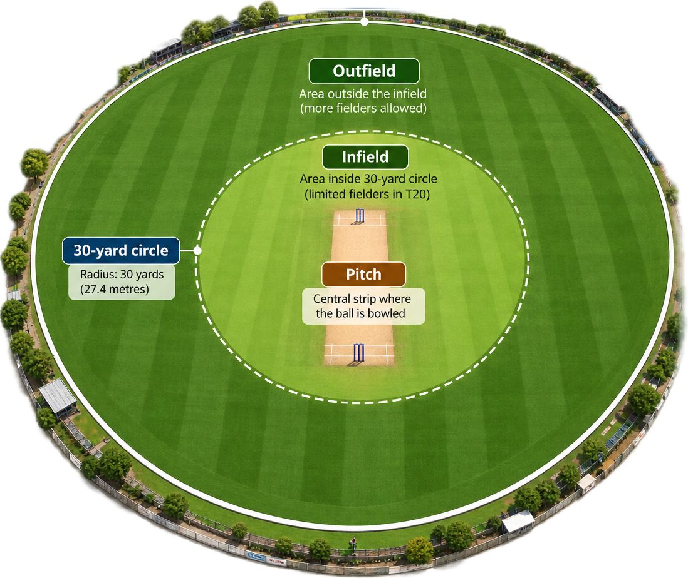

```{r}
#| label: load-packages
#| include: false

library(knitr)
library(ggplot2)
library(dplyr)

options(width = 70)
```


### Introduction - About Cricket

:::: {.columns}

::: {.column width="48%"}
{width=100%}

<div style="text-align:center; font-size:0.82em; margin-top:8px; line-height:1.45;">
<strong>Batting team:</strong> scores runs<br>
<strong>Bowling team:</strong> takes wickets
</div>
:::

::: {.column width="52%"}

#### T20 Cricket

- **20 overs per team**
- **6 legal balls per over**
- **10 wickets maximum**
- **First innings:** sets the target
- **Second innings:** chases the target
- **Toss:** choose to bat or field
- **Win:** finish with the higher score

:::

::::

---


###Research Questions

:::: {.columns}

::: {.column width="50%"}


:::

::: {.column width="50%"}

<div style="font-size:0.55em; line-height:1.2; padding-top:10px;">

#### 1. Scoring & Wickets by Phase

**How do scoring rates and wicket probabilities vary across the three phases of a T20 innings?**

- **Powerplay:** 1–6
- **Middle:** 7–16
- **Death:** 17–20

<br>

#### 2. Batter Performance Under Pressure

**Which batters perform best under high-pressure chase situations compared with low-pressure situations?**

Pressure depends on:

- **Required run rate**
- **Wickets in hand**
- **Balls remaining**

</div>

:::

::::

---

##### Can we build a model that predicts the probability of a wicket falling on any given delivery, using match-state and player-identity features?

---

##### Which bowlers are most effective at restricting runs and taking wickets in the death overs, after controlling for the match state they bowl in?

---

##### Does winning the toss and choosing to field (the more common decision in T20) actually translate into a meaningful advantage?

---

##### Do players naturally cluster into distinct batting or bowling archetypes based on their ball-by-ball performance profiles?
